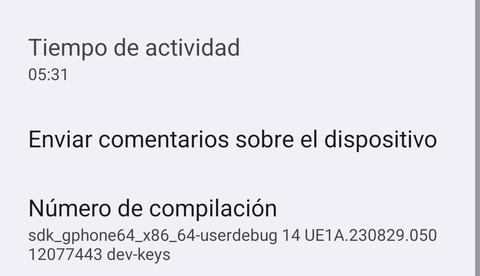
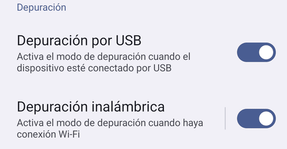
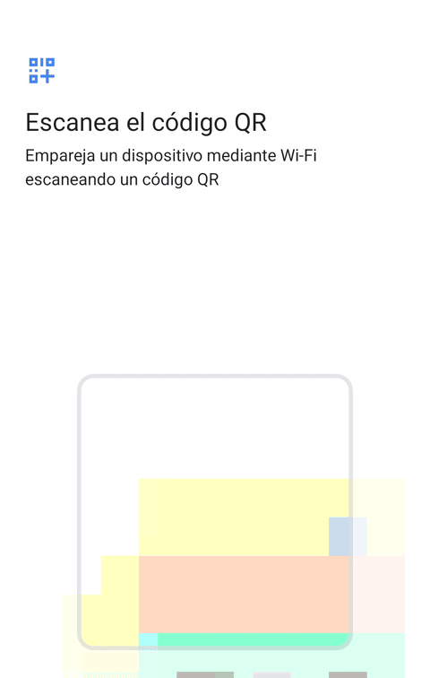
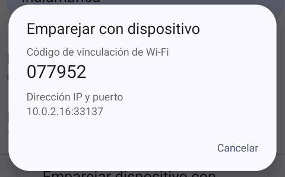

# Prepara tu móvil para ADBuddy

[Read in English](../)

ADBuddy habla con tu móvil por **depuración inalámbrica**, una opción de desarrollador que trae Android 11 y posteriores. Se activa una sola vez; después el PC encuentra el móvil solo en tu Wi-Fi.

Deja `adbuddy setup` en marcha en el PC mientras sigues estos pasos.

## 1. Activa las opciones de desarrollador

1. Abre **Ajustes → Información del teléfono**.
2. Toca **Número de compilación** siete veces. Puede que el móvil te pida el PIN.
3. Verás "¡Ya eres desarrollador!".

{: width="240"}

En algunos móviles, **Número de compilación** está en **Ajustes → Información del teléfono → Información de software**.

## 2. Activa la depuración inalámbrica

1. Abre las **Opciones para desarrolladores**: en un Pixel están en **Ajustes → Sistema → Opciones para desarrolladores**; en otros móviles, normalmente al final de **Ajustes**.
2. Activa **Depuración inalámbrica**.
3. Cuando el móvil pregunte "¿Permitir la depuración inalámbrica en esta red?", marca **Permitir siempre en esta red** y toca **Permitir**. Así esa red queda como red de confianza y el móvil se vuelve a conectar solo en ella.

{: width="240"}

El móvil y el PC tienen que estar en la **misma red Wi-Fi**.

## 3. Empareja con el código QR

`adbuddy setup` muestra dos códigos QR. El primero abre esta guía y se escanea con la cámara. El de emparejar es el **segundo**, el que aparece bajo "On the phone: Wireless debugging → Pair device with QR code, and scan:".

1. Toca las palabras **Depuración inalámbrica** (no el interruptor) para abrir su pantalla.
2. Toca **Emparejar dispositivo con código QR**.
3. Escanea el **segundo** código QR con el lector que se abre en el móvil, no con la app de la cámara.

{: width="240"}

El móvil muestra el PC en **Dispositivos emparejados** y el terminal dice "Paired".

Tienes unos 3 minutos desde que aparece el segundo código QR.

### Si el código QR no funciona

Ejecuta `adbuddy setup --code`:

1. En el móvil, toca **Emparejar dispositivo con código de sincronización**. Deja ese cuadro abierto hasta que el terminal diga "Paired": si lo cierras, el código deja de valer.
2. Escribe en el terminal la **dirección IP y puerto** y el **código de vinculación de Wi-Fi** de 6 cifras que aparecen dentro de ese cuadro, no la dirección IP y el puerto de la pantalla principal de Depuración inalámbrica.

{: width="240"}

### Si el móvil está en otra red (Tailscale)

El código QR solo funciona en la misma red. Por Tailscale, o en una Wi-Fi que bloquea mDNS:

1. Ejecuta `adbuddy setup --code` y empareja como arriba: con Tailscale activo, el cuadro de emparejamiento muestra la IP de Tailscale del móvil.
2. Cuando setup pida la **Connection address** (dirección de conexión), escribe la dirección IP y el puerto de la pantalla principal de Depuración inalámbrica (o pásala de entrada: `adbuddy setup --code --connect <ip:puerto>`).
3. El puerto cambia cada vez que se vuelve a activar la depuración inalámbrica. Cuando `adbuddy serve` no llegue al móvil, ejecuta `adbuddy connect <nueva ip:puerto>` con la dirección que muestre el móvil en ese momento.

## Si algo falla

- **"No se ve ningún móvil con la depuración inalámbrica en esta red"**: mientras espera el código QR, el PC no ve ningún móvil con la depuración inalámbrica. Si el móvil está en otra red (por ejemplo, Tailscale) o la Wi-Fi bloquea mDNS, pulsa Ctrl+C y ejecuta `adbuddy setup --code` (mira el apartado anterior).
- **El móvil no aparece:** comprueba que los dos están en la misma Wi-Fi, que la depuración inalámbrica sigue activa (Android la apaga al cambiar de red, salvo en redes de confianza) y que la red no aísla a sus clientes (las redes de invitados suelen hacerlo).
- **Se acabó el tiempo (`PAIRING_TIMEOUT`):** el móvil tiene unos 3 minutos para escanear el código QR desde que aparece. Vuelve a ejecutar `adbuddy setup`; se salta lo que ya está hecho.
- **"Wrong password" (contraseña incorrecta):** el código cambia cada vez que se abre el cuadro; usa el que se ve en ese momento.
- **`protocol fault` al emparejar con código:** el cuadro se cerró antes de terminar el emparejamiento. También se cierra si cambias a otra app para copiar el código. Mantenlo abierto y escribe el código desde el PC (o desde otro dispositivo), o ábrelo de nuevo para obtener un código nuevo.
- **Windows pregunta por el cortafuegos:** permite adb (la herramienta de depuración de Android, que ADBuddy descarga) en redes privadas; solo habla con dispositivos de tu Wi-Fi.

## Qué pasa después

Tras "Paired", `adbuddy setup` hace el resto por sí solo, en este orden. No tienes que escribir nada salvo que te lo pida.

1. **Conecta.** Se conecta al móvil e intenta comprobar que es el que acabas de emparejar. Si no puede comprobarlo, imprime una línea "Note: could not check…" y sigue. Si el móvil no aparece solo, pide la dirección de la pantalla de Depuración inalámbrica.
2. **Lee el perfil del móvil.** Imprime `Phone: <modelo>, Android <versión>.` El perfil pasa después a las instrucciones del agente.
3. **Instala la app de ADBuddy en el móvil.** Setup instala la app solo si el móvil aún no la tiene, o si pasas `--apk <archivo>`. Solo la descarga de una release pública cuando exista una, y solo si el host conoce el certificado de firma del proyecto. Hoy no hay release pública, así que setup dice que se salta la app y sigue. Para instalar la app ahora, compila el APK ([Instalación](../../install.md#build-from-source), en inglés) y ejecuta:

   ```sh
   adbuddy setup --apk <file>
   ```

   Ese APK no está firmado con la clave del proyecto, así que setup confía en ese archivo exacto como tu build de desarrollo y lo dice. Tras instalar, setup comprueba el certificado de firma de la app y su versión. Si la comprobación falla, no configura la app y sigue. Sin la app, el host funciona igual, pero confirmas en el terminal y no hay chat en el móvil. `adbuddy setup --no-app` se salta la app a propósito.
4. **Pide tu consentimiento en el móvil.** La app de ADBuddy se abre en el móvil con `Configurar ADBuddy con <nombre del PC>`. Dice que, si aceptas, el PC va a:
   - dar a ADBuddy el permiso para cambiar ajustes seguros, que usa para cortar y reactivar desde el móvil el acceso del PC por adb;
   - quitar a ADBuddy de la optimización de batería, para que el canal con el PC siga abierto;
   - activar el servicio de accesibilidad de ADBuddy, sin quitar ninguno de los que ya uses.

   Toca **Aceptar** o **Ahora no**. Setup espera hasta 5 minutos. Si tocas **Ahora no** o no respondes, setup sigue sin configurar la app y puedes volver a ejecutar `adbuddy setup` más tarde. Cuando aceptas, setup imprime `The ADBuddy app is ready (version <número>).` Si falló alguno de los tres pasos, imprime "The ADBuddy app is only partly ready" y los avisos de encima dicen cuál.
5. **Elige el agente.** Busca Claude Code, Codex, Gemini CLI y OpenCode en tu `PATH`. Si tienes varios, pregunta cuál usar. `--agent <nombre>` y `--yes` se saltan la pregunta. Si no hay ninguno instalado, dice cómo instalar uno. ADBuddy no instala agentes.
6. **Crea el entorno.** El entorno es la carpeta donde trabaja el agente: `~/ADBuddy/<nombre del móvil>/`. El nombre del móvil es su modelo en minúsculas y con guiones. La carpeta contiene las instrucciones y las skills del agente, con el perfil del móvil, y el shim (un sustituto de `adb` que clasifica cada comando por riesgo y lo apunta en el diario). Setup también guarda tus elecciones. Después imprime una línea que empieza por "Ready:".

Puedes volver a ejecutar setup, con `adbuddy serve` parado. Se reconecta, vuelve a pedir tu consentimiento y reescribe las instrucciones y las skills del agente (`NOTES.md` se queda como está). También apaga el modo remoto. Si el móvil que configuraste antes responde en la red, setup lo encuentra ("Found it: already paired.") y se salta la guía y el código QR.

## Qué hace ADBuddy con este acceso

El agente trabaja a través del shim de ADBuddy, que clasifica cada comando por riesgo, lo apunta en un diario con su forma de deshacerlo y hace esperar tu confirmación a los comandos que clasifica como rojos (los toques y la escritura no se preguntan). El shim protege contra errores e inyecciones de prompts, no contra un agente empeñado en buscar otro adb: para eso, el interruptor real es **Cortar acceso** en la app. Setup nunca pide ni guarda el PIN del móvil. [Seguridad](../../safety.md), en inglés, tiene los detalles.

## Siguiente: arranca ADBuddy

1. En un terminal, arranca el host y déjalo abierto:

   ```sh
   adbuddy serve
   ```

   Por defecto también arranca el agente. Abre la app de ADBuddy en el móvil para chatear con él, o ejecuta `adbuddy attach` en un segundo terminal.

2. Si prefieres ejecutar el agente en un terminal propio, arranca el host con `adbuddy serve --no-agent` y ejecuta `adbuddy run` en otro terminal. Pierdes el chat en el móvil.

[Usage](../../usage.md) (en inglés) tiene los detalles. Si algo falla, mira [Troubleshooting](../../troubleshooting.md) (en inglés). Para instalar o actualizar el host, mira [Install](../../install.md) (en inglés).
