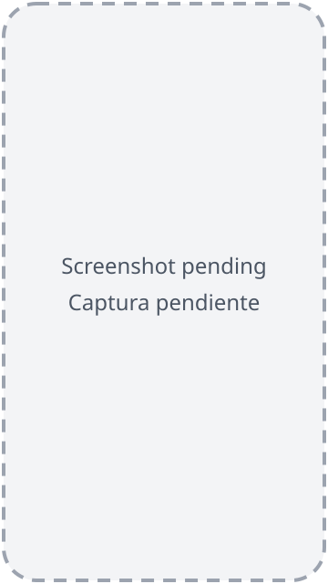

# Set up your phone for ADBuddy

[Leer en español](es/)

ADBuddy talks to your phone over **wireless debugging**, a developer option built into Android 11 and newer. You turn it on once; after that the PC finds the phone by itself on your Wi-Fi.

Keep `adbuddy setup` running on the PC while you follow these steps.

## 1. Turn on Developer options

1. Open **Settings → About phone**.
2. Tap **Build number** seven times. The phone may ask for your PIN.
3. You will see "You are now a developer!".

{: width="240"}

On some phones **Build number** is under **Settings → About phone → Software information**.

## 2. Turn on Wireless debugging

1. Open **Developer options**: on a Pixel it is in **Settings → System → Developer options**; on other phones it is usually at the end of **Settings**.
2. Turn on **Wireless debugging**.
3. When the phone asks "Allow wireless debugging on this network?", tick **Always allow on this network** and tap **Allow**. This network becomes a trusted network: the phone reconnects on it by itself.

{: width="240"}

The phone and the PC must be on the **same Wi-Fi network**.

## 3. Pair with the QR code

`adbuddy setup` shows two QR codes. The first one opens this guide and is scanned with the camera. The one to pair with is the **second** QR code, the one shown under "On the phone: Wireless debugging → Pair device with QR code, and scan:".

1. Tap the words **Wireless debugging** (not the switch) to open its screen.
2. Tap **Pair device with QR code**.
3. Scan the **second** QR code with the scanner that opens on the phone, not with the camera app.

{: width="240"}

The phone shows the PC in **Paired devices** and the terminal says "Paired".

You have about 3 minutes from the moment the second QR code appears.

### If the QR code does not work

Run `adbuddy setup --code` instead:

1. On the phone, tap **Pair device with pairing code**. Keep that popup open until the terminal says "Paired": closing it cancels the code.
2. Type into the terminal the **IP address & Port** and the 6-digit **Wi-Fi pairing code** shown inside that popup, not the IP address and port on the main Wireless debugging screen.

{: width="240"}

### If the phone is on another network (Tailscale)

The QR code only works on the same network. Over Tailscale, or on a Wi-Fi that blocks mDNS:

1. Run `adbuddy setup --code` and pair as above: with Tailscale on, the pairing popup shows the phone's Tailscale IP.
2. When setup asks for the **Connection address**, type the IP address and port on the main Wireless debugging screen (or pass it up front: `adbuddy setup --code --connect <ip:port>`).
3. The port changes every time wireless debugging is turned on again. When `adbuddy serve` cannot reach the phone, run `adbuddy connect <new ip:port>` with the address the phone shows now.

## Troubleshooting

- **"I can't see any phone with wireless debugging on this network"**: while the QR code waits, the PC sees no phone with wireless debugging at all. If the phone is on another network (for example Tailscale) or the Wi-Fi blocks mDNS, press Ctrl+C and run `adbuddy setup --code` (see above).
- **The phone never shows up**: check that both are on the same Wi-Fi, that wireless debugging is still on (Android turns it off when you change network unless the network is trusted) and that the network does not isolate its clients (guest networks often do).
- **Setup timed out (`PAIRING_TIMEOUT`)**: the phone has about 3 minutes to scan the QR code from the moment it appears. Run `adbuddy setup` again; it skips what is already done.
- **"Wrong password"**: the pairing code changes every time the popup opens; use the current one.
- **`protocol fault` when pairing with a code**: the popup closed before pairing finished. It also closes when you switch to another app to copy the code. Keep it open, type the code from the PC (or from another device), or open it again for a new code.
- **Windows asks about the firewall**: allow adb (Android's debugging tool, which ADBuddy downloads) on private networks; it only talks to devices on your Wi-Fi.

## What ADBuddy does with this access

Every command the agent sends goes through ADBuddy: it is classified by risk, written to a journal with its undo, and anything irreversible waits for your confirmation. Your PIN is never asked for or stored.
